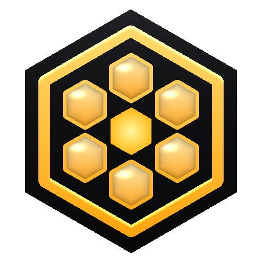
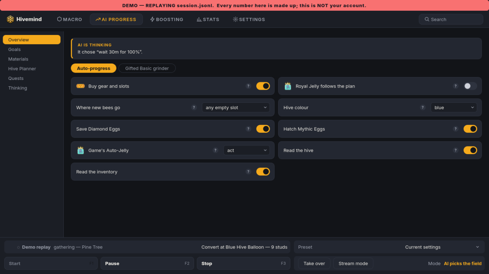
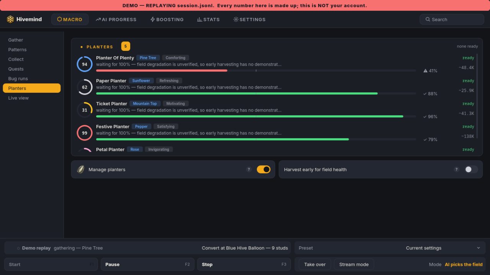
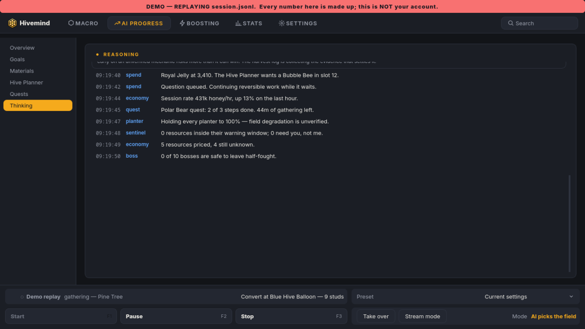
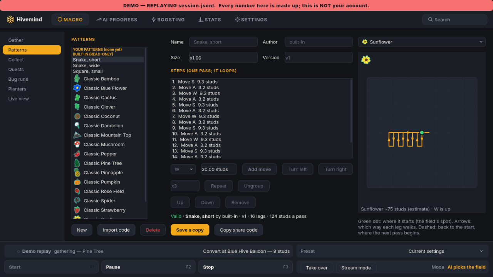
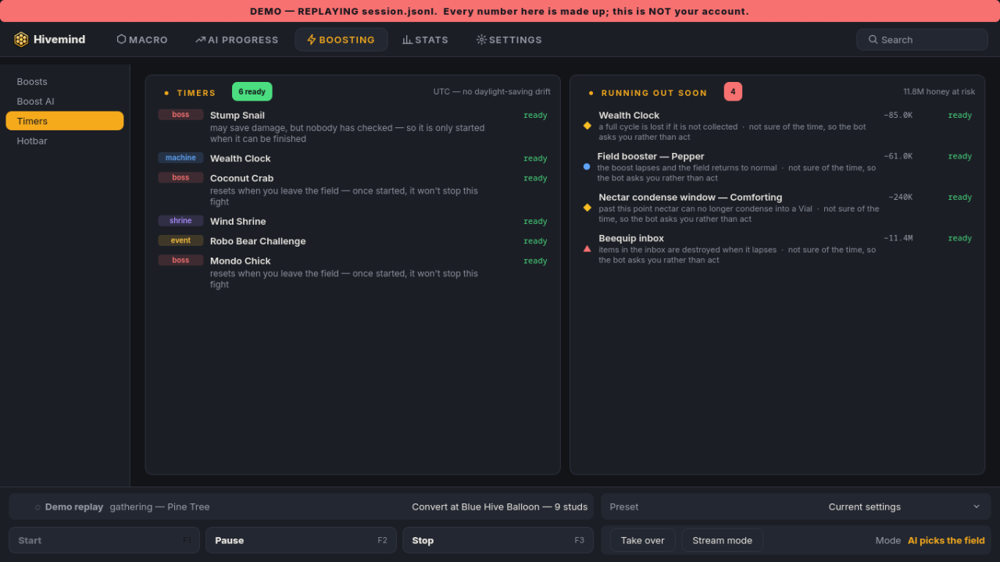

<p align="center">
  
</p>

<h1 align="center">Hivemind</h1>

<p align="center">
  <b>A free, open-source bot that plays Bee Swarm Simulator by looking at the screen, like you do.</b>
</p>

<p align="center">
  <a href="LICENSE"></a>
  
  
</p>

<p align="center">
  
</p>

> **Right now you can download the UI Preview.** It is the Hivemind app with
> made-up demo numbers, so you can look around. **Start does nothing** in the
> preview: it cannot play the game. Test builds of the real bot come later.

<sub>Hivemind is an unofficial fan project. It is not made, endorsed or
supported by Roblox Corporation or by Onett, the creator of Bee Swarm
Simulator. It is free software with **no warranty**: use it at your own risk
(see the [FAQ](#faq) and [`LICENSE`](LICENSE)).</sub>

## Contents

- [Download the UI Preview](#download-the-ui-preview)
- [Screenshots](#screenshots)
- [What it does](#what-it-does)
- [Safety](#safety)
- [FAQ](#faq)
- [Roadmap](#roadmap)
- [Run from source](#run-from-source)
- [Credits](#credits)
- [Contributing](#contributing)
- [Licence](#licence)

## Download the UI Preview

Get the files from the
[Releases page](https://github.com/OfficialHivemind/Project-Hivemind/releases).

### Windows

1. Download **`Hivemind-UI-Preview.exe`** (one file, about 156 MB).
2. Double-click it and follow the installer. It installs for your user only,
   so it does not ask for an admin password.
3. Open **Hivemind UI Preview** from the Start menu.

### Linux

1. Download **`Hivemind-UI-Preview-x86_64.AppImage`** (one file, about 179 MB).
2. Make it executable: right-click it, open Properties and tick "Allow
   executing file as program". Or run `chmod +x Hivemind-UI-Preview-x86_64.AppImage`.
3. Double-click it.

### "Windows protected your PC" or an antivirus warning

The installer is **not code-signed yet**, and Windows
warns about any program it has not seen many times before. If SmartScreen
says "Windows protected your PC", click **More info**, then **Run anyway**.

Some antivirus programs scan a new installer before it opens, and may cover
the setup window for a moment. That is normal: let the scan finish. If your
antivirus is worried, you can read every line of the code here, or build the
installer yourself (see `installer/README.md`).

## Screenshots

All numbers in these pictures are made up by the demo.

| | |
|---|---|
|  |  |
| **Planters**: what is growing where, and when to harvest. | **Thinking**: the AI writes down each choice and why. |
|  |  |
| **Pattern studio**: view, make and share gather patterns. | **Timers**: bosses, machines and boosts that are ready. |

## What it does

The full bot (not the preview) is built to:

- **Gather and make honey by itself**: walk to a field, run a gather
  pattern, watch the backpack, walk home, convert, and repeat.
- **Plan what to do next**: pick fields by measured honey per hour, buy gear
  in a sensible order, place and harvest planters, hatch eggs and use items.
- **Do quests and fight**: read quest text, talk to the bears, and hunt the
  mobs and bosses it can handle.
- **Chase tokens**: see tokens and bubbles on screen and decide which ones
  are worth walking to.
- **Recover**: notice deaths, disconnects and getting lost, and find its way
  back to the hive.
- **Explain itself**: a desktop app with a live view, settings, the pattern
  studio, stats and a page where the AI explains every decision.
- **Send alerts if you want them**: Telegram and Discord messages and simple
  remote commands (pause, stop, screenshot, report). Off unless you set them up.

Hivemind is still being tested. Some parts work better than others, and it
gets better with every test run.

## Safety

- **It only looks at the screen.** It reads the game from screenshots (text
  reading and image matching) and plays with keyboard and mouse input, like
  a person.
- **No memory reading, no injection.** It never reads or changes the game's
  memory and never injects code into Roblox.
- **No Robux, ever.** It never spends Robux and never buys anything with real
  money.
- **Panic key.** Press **F12** to stop the bot at once.
- **Your secrets stay on your PC.** Tokens and private-server links are kept
  in your own config folder, readable only by you. See
  [`docs/SECURITY.md`](docs/SECURITY.md).

## FAQ

**Is it safe to install?**
The preview is a normal desktop app with demo data. It does not open Roblox
or touch your account. The code is all here for anyone to read, and the
installer is built from this code.

**Will I get banned?**
We can't promise you won't. Using a bot or macro can break Roblox's rules or
the game's rules, and any account that uses one takes that risk. Hivemind
plays only through the screen, keyboard and mouse, but that does not make it
allowed. It is your choice and your account.

**Does it work on Mac?**
Not yet. A Mac version is on the list for later.

**Why is it GPL-3.0?**
Hivemind's gather patterns and field paths come from
[Natro Macro](https://github.com/NatroTeam/NatroMacro), which is GPL-3.0, so
Hivemind is GPL-3.0 too. It also means Hivemind stays free: anyone who shares
a changed copy must share its code as well.

**Does it cost anything?**
No. Hivemind is free.

## Roadmap

- **Now:** the UI Preview, so people can try the app and tell us what they think.
- **Next:** test builds of the real bot for testers, on Windows and Linux.
- **Later:** a Mac version, and more of the ideas the community has sent in.

## Run from source

For developers. Linux needs Python 3.12+, a Wayland desktop, Sober (the
Roblox client for Linux) and Hyprland 0.56 or newer; the full steps are in
[`installer/linux/README-LINUX.md`](installer/linux/README-LINUX.md).
Windows steps are in [`installer/README.md`](installer/README.md).

```sh
make venv                                   # Linux: .venv with the system packages
PYTHONPATH=src:. .venv/bin/python -m pytest -q tests/unit
.venv/bin/python -m hivemind.gui --demo     # the app with demo data
```

## Credits

- **[Natro Macro](https://github.com/NatroTeam/NatroMacro)** (GPL-3.0): Hivemind's
  gather patterns and field paths are derived from it. Thank you to the
  Natro team.
- **The [Bee Swarm Simulator Fandom wiki](https://bee-swarm-simulator.fandom.com)**
  (CC BY-SA 3.0): game facts and reference pictures.
- **The community**: everyone whose idea is built or planned is thanked by
  name in the app itself (**Settings → Credits**).

Full notices are in [`NOTICE.md`](NOTICE.md). Bee Swarm Simulator and Roblox
belong to their owners. Hivemind is an unofficial fan project, not made or
endorsed by Onett or Roblox Corporation.

**Own something in this repository and want it removed?** Open an issue
saying what it is, and it will be taken down.

## Contributing

Bug reports, ideas and pull requests are welcome, from beginners too. Read
[`CONTRIBUTING.md`](CONTRIBUTING.md) to get started, and please follow the
[Code of Conduct](CODE_OF_CONDUCT.md). What changed in each release is in
[`CHANGELOG.md`](CHANGELOG.md).

## Licence

Hivemind is free software under the
[GNU General Public License v3.0](LICENSE).
